<div align="center">


### 티켓 오픈 정각에 몰려도, 한 좌석은 한 사람에게만

내일배움캠프 Spring 심화 10기 최종 프로젝트 · 5조 **이선좌** · 2026.10.26 ~ 11.19

<sub>"이선좌"는 티켓팅을 하다 보면 자주 보게 되는 "<b>이</b>미 <b>선</b>택된 <b>좌</b>석입니다"의 줄임말이다.</sub>

<br>

<a href="https://52.63.10.174"></a>
<a href="https://52.63.10.174/api/docs"></a>
<a href="https://52.63.10.174/grafana/"></a>
<a href="https://app.notion.com/p/teamsparta/5-4132dc3ef51480cc8559f3f3778e0f1b"></a>


</div>

<br>

티켓 오픈 정각에 접속이 몰려도 한 좌석은 한 사람에게만 팔고, 손이 빠르지 않더라도 추첨과 자동결제로 예매할 기회를 만드는 콘서트 예매 서버다. 5명이 약 4주 동안 서비스 3개(User·Reservation·Payment)와 API Gateway, AI 상담 서비스를 만들었다. 설계 정본은 Notion [SA MASTER v3.3](https://app.notion.com/p/6867bd823b7583f9896c81d8881f0004)이고, 저장소 사본은 [`docs/core/SA MASTER.md`](docs/core/SA%20MASTER.md)다.

<details>
<summary><b>목차</b></summary>

1. [한눈에 보기](#한눈에-보기)
2. [무엇을 만들었나](#무엇을-만들었나)
3. [구조](#구조)
4. [예매와 결제가 맞물리는 방식](#예매와-결제가-맞물리는-방식)
5. [성능: 측정으로 확인한 것](#성능-측정으로-확인한-것)
6. [정합성: 돈이 걸린 곳](#정합성-돈이-걸린-곳)
7. [운영: 배포와 알림](#운영-배포와-알림)
8. [AI와 일하는 방식](#ai와-일하는-방식)
9. [기술적 의사결정](#기술적-의사결정)
10. [알려진 한계](#알려진-한계)
11. [팀](#팀)
12. [저장소 구성](#저장소-구성)
13. [팀원을 위한 안내](#팀원을-위한-안내)

</details>

## 한눈에 보기

<table>
  <tr>
    <td align="center" width="25%"><h3>0건</h3><b>중복 판매</b><br><sub>모든 배포 측정에서<br>확정 예매 = 결제 승인<br>= 판매된 좌석</sub></td>
    <td align="center" width="25%"><h3>p95 −85%</h3><b>Gateway 과부하</b><br><sub>초당 2,000건, 굿풋 +30%<br>동시 처리 상한 64 전후</sub></td>
    <td align="center" width="25%"><h3>100%</h3><b>추첨 자동결제 10분 안</b><br><sub>당첨 약 2,000건<br>개선 전 92.4~93.4%</sub></td>
    <td align="center" width="25%"><h3>34 = 34</h3><b>PG 원장 = 결제 DB</b><br><sub>결제 서버를 강제로 종료해도<br>중복 승인 0건</sub></td>
  </tr>
  <tr>
    <td align="center"><h3>2,020개</h3><b>테스트</b><br><sub>Java <code>@Test</code> 1,968<br>+ 매개변수 테스트 52<br>프론트엔드는 따로 약 1,230</sub></td>
    <td align="center"><h3>806건</h3><b>AI 판단 기록</b><br><sub>개별 기록 241건 중<br>94건(39%)은 AI 제안 거부</sub></td>
    <td align="center"><h3>63 · 74</h3><b>ADR · 트러블슈팅</b><br><sub>되돌리기 어려운 결정과<br>막혔던 문제를 모두 저장소에</sub></td>
    <td align="center"><h3>37개</h3><b>알림 규칙</b><br><sub>promtool 테스트 64건으로<br>제때 울리는지까지 검사</sub></td>
  </tr>
</table>

> [!NOTE]
> 성능 수치는 모두 배포 서버(EC2 m7i.xlarge, 4 vCPU 1대)와, 같은 VPC에 둔 별도 부하 발생기(k6)로 측정했다. 로컬 PC에서 잰 값은 따로 "로컬"이라고 적었고, 측정한 날이 다른 결과끼리는 %로 비교하지 않았다.

## 무엇을 만들었나

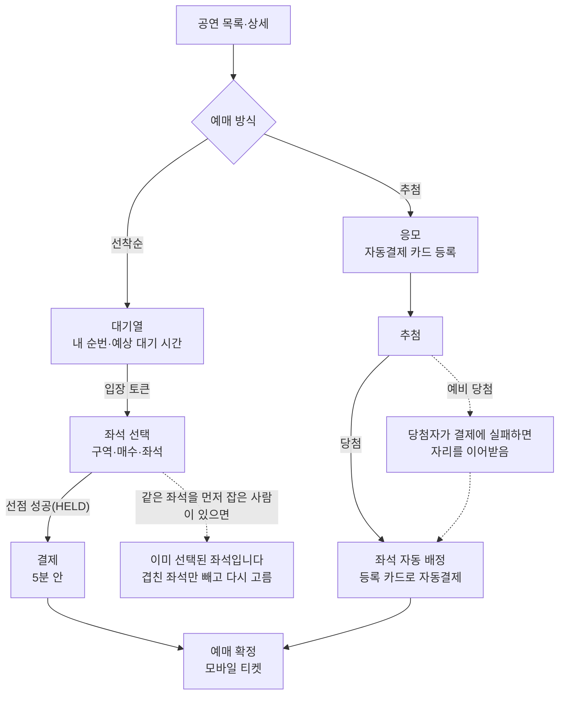

| 예매 방식 | 사용자 경험 |
|---|---|
| 🎟️ **선착순 예매** | 대기열에서 내 순번과 예상 대기 시간을 보다가 입장하면 구역·매수·좌석을 고른다. 여러 사람이 같은 좌석을 동시에 누르면 한 사람만 성공하고, 나머지에게는 "이미 선택된 좌석입니다"가 표시된다. 선택을 마치면 5분 안에 결제한다 |
| 🎲 **추첨 예매** | 응모하면서 자동결제 카드를 등록해 둔다. 추첨이 끝나면 당첨자에게 좌석이 자동으로 배정되고 등록한 카드로 결제된다. 결제에 실패하면 예비 당첨자가 자리를 이어받는다 |
| 💬 **AI 예매 상담** | 취소·환불·추첨 규정을 물으면 규정 문서에서 찾은 근거와 함께 답한다. 상담 서비스가 멈춰도 예매와 결제는 그대로 동작한다 |

<table>
  <tr>
    <td width="50%">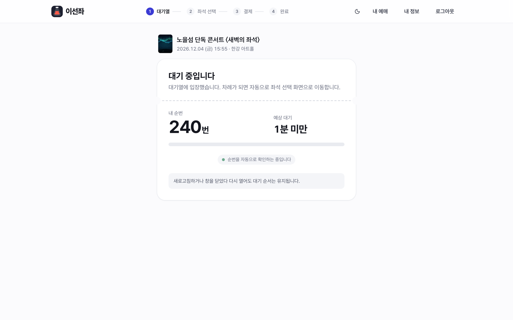</td>
    <td width="50%">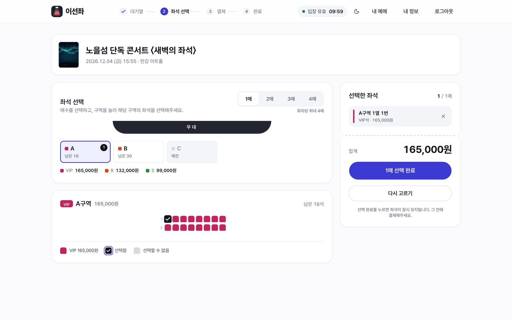</td>
  </tr>
  <tr>
    <td align="center"><b>① 대기열</b> · 내 순번과 예상 대기 시간</td>
    <td align="center"><b>② 좌석 선택</b> · 구역·매수·좌석</td>
  </tr>
  <tr>
    <td>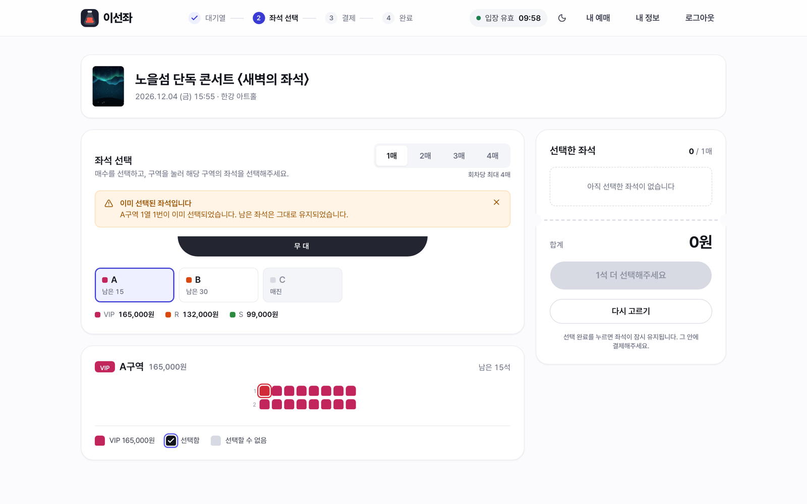</td>
    <td>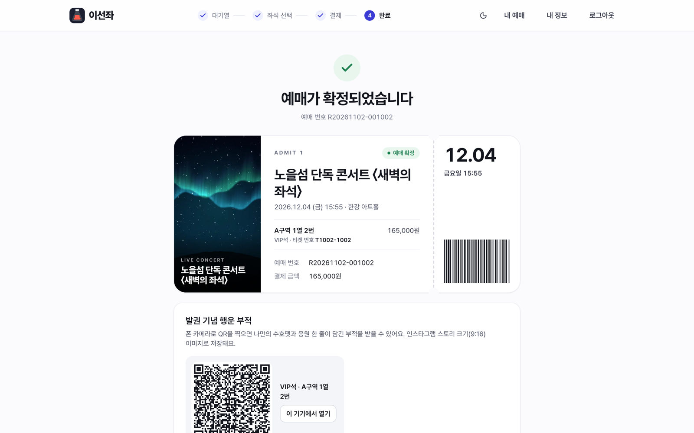</td>
  </tr>
  <tr>
    <td align="center"><b>③ 이미 선택된 좌석입니다</b> · 한 사람만 성공</td>
    <td align="center"><b>④ 예매 확정</b> · 모바일 티켓</td>
  </tr>
  <tr>
    <td>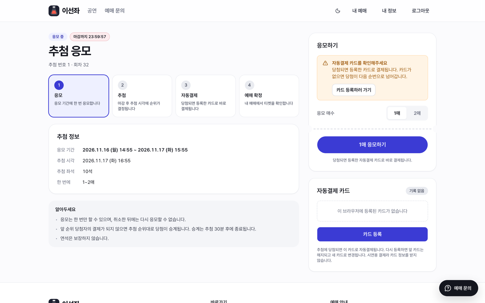</td>
    <td>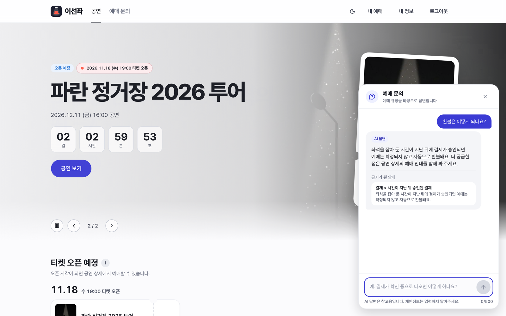</td>
  </tr>
  <tr>
    <td align="center"><b>추첨 응모</b> · 자동결제 카드 등록</td>
    <td align="center"><b>AI 예매 상담</b> · 규정 문서 근거 인용</td>
  </tr>
</table>

<details>
<summary><b>화면마다 실패하면 어디로 가는지: 일반 예매 유저 플로우 전체</b></summary>

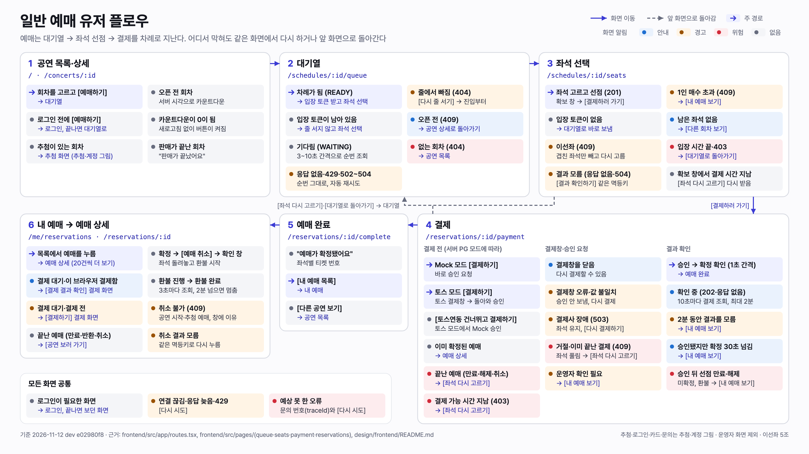

추첨·로그인·카드 화면은 [추첨·계정 유저 플로우](docs/presentation/architecture/2026-11-12-user-flow-lottery-account.png)에 있다.

</details>

화면 32장은 [`docs/presentation/demo/2026-11-16-screens/`](docs/presentation/demo/2026-11-16-screens/)에 있다.

## 구조

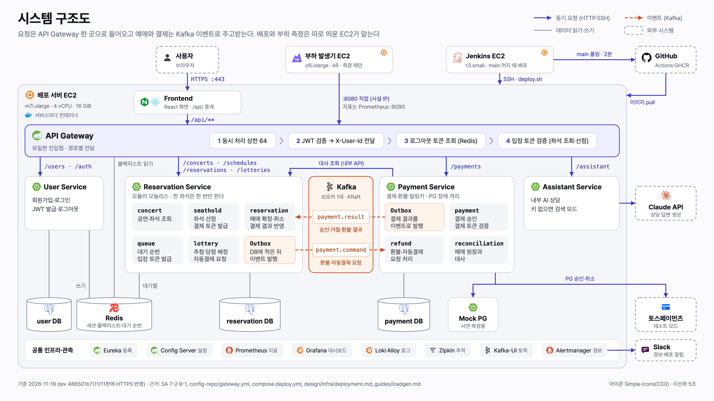

### 요청 경로

모든 요청은 Gateway 한 곳으로 들어온다. 넘친 요청은 인증보다 먼저 거절해, 이미 받은 요청이 끝까지 처리될 자리를 지킨다.

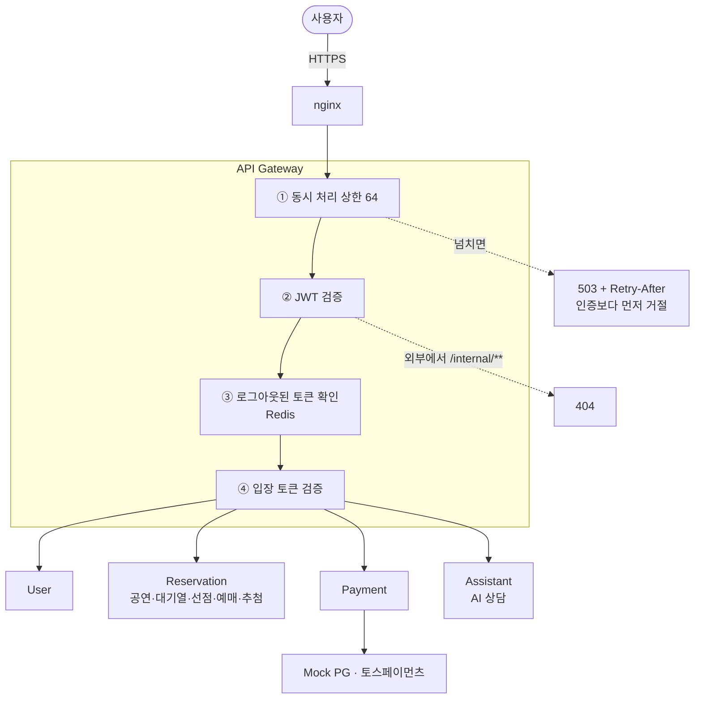

- **서비스**: User, Reservation(공연·대기열·선점·예매·추첨 모듈의 모듈러 모놀리스), Payment, Assistant(AI 상담), Mock PG. DB는 서비스마다 따로 둔다(PostgreSQL 17 × 3).
- **서비스 경계를 3개로 정한 이유**: 처음 안은 5개였다. 대기열은 자체 데이터가 없고 멈추면 예매도 멈추므로 떼어 내도 장애가 격리되지 않고, 추첨석은 `LOTTERY` 등급으로 나누면 같은 DB 안에서도 실시간 선점과 충돌하지 않는다. 그래서 둘 다 예매 서비스 안의 모듈로 두고, 분리할 조건을 측정 지표로 정해 두었다(SA 7-1).
- **이벤트**: `payment.result`, `payment.command`, `seat-hold.request`와 각각의 DLQ. 모든 발행은 Outbox를 거친다.

### 기술 스택

| 영역 | 기술 |
|---|---|
| 백엔드 | Java 21, Spring Boot 4.1.2, Spring Cloud 2025.1.4(Gateway·Eureka·Config), Resilience4j, JPA·Flyway |
| 데이터·메시징 | PostgreSQL 17, Redis 8, Kafka 4.1.1(KRaft) |
| 프론트엔드 | React 19, Vite, TanStack Query, MSW, Playwright |
| 배포 | GitHub Actions → GHCR → Jenkins → EC2 한 대(컨테이너 21개), 실패하면 자동 되돌림 |
| 관측 | Prometheus·Grafana(대시보드 6개), Loki·Alloy, Zipkin, Alertmanager → Slack |
| 부하·AI | k6 1.0.0, Claude API(`anthropic-java`), springdoc(Swagger UI) |

## 예매와 결제가 맞물리는 방식

### 결제 SAGA

예매와 결제는 서로의 DB를 건드리지 않는다. 결제 서비스는 결과를 이벤트로 남기고, 예매 서비스가 그 이벤트를 받아 자기 상태를 바꾼다. PG 호출은 트랜잭션 밖에서 한다.

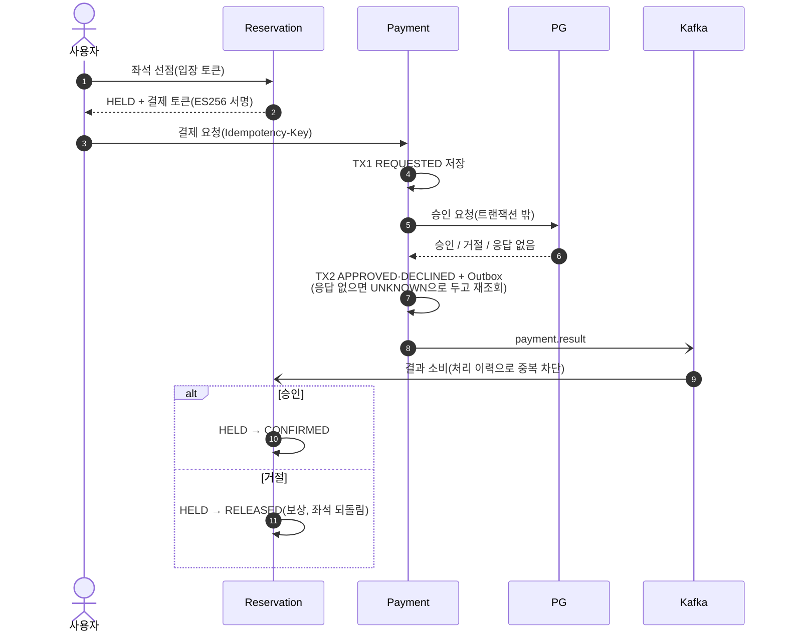

<details>
<summary><b>배포 서버에서 돌린 거절 보상: 결제 거절을 기록하고 약 0.14초 뒤 좌석이 돌아옴</b></summary>

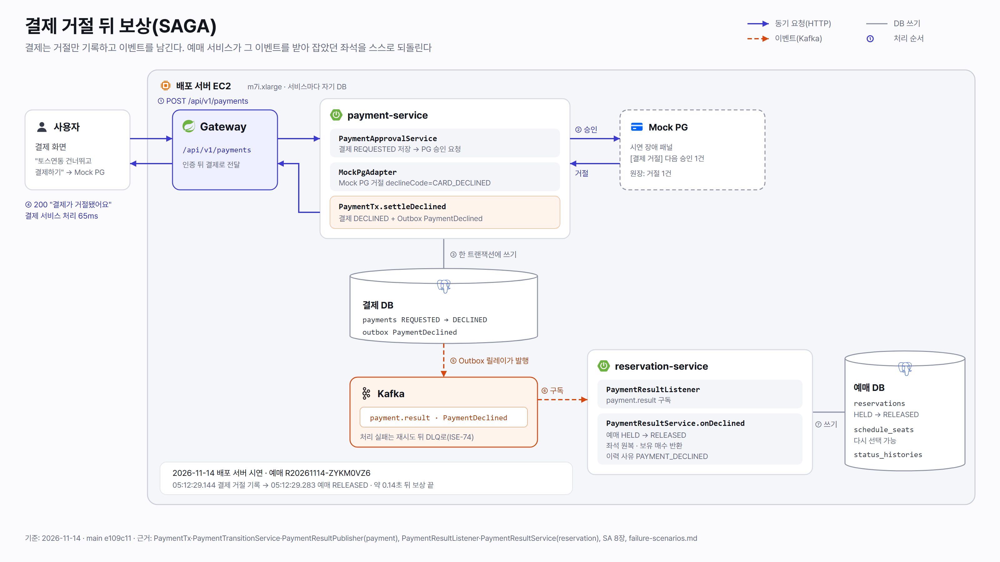

</details>

### 상태 전이

예매와 결제는 상태를 "이전 상태일 때만" 바꾸는 조건부 갱신으로 옮긴다. 결과를 모를 때는 실패로 단정하지 않고 `UNKNOWN`으로 두었다가 다시 조회해 확정한다.

**예매(Reservation)**

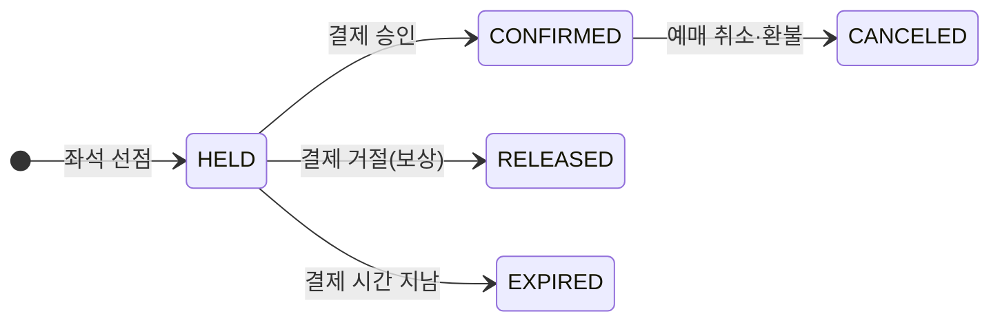

**결제(Payment)**

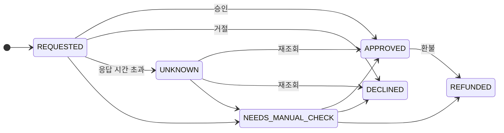

### 추첨과 자동결제

추첨 당첨은 "시스템이 대신 선점한 일반 예매"로 다룬다. 당첨자에게 일반 예매와 같은 `HELD` 예매를 만들고 같은 결제 경로로 보내므로, 확정·만료·환불을 추첨용으로 새로 만들지 않았다.

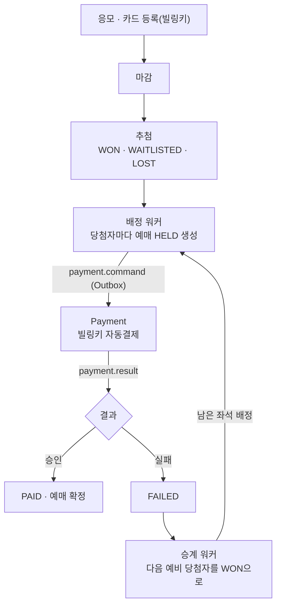

자세한 흐름과 시간 예산은 [추첨 설계](docs/design/lottery/README.md)에 있다.

## 성능: 측정으로 확인한 것

| 영역 | 개선 전 → 후 | 조건 |
|---|---|---|
| Gateway 과부하 | 굿풋 1,304 → 1,696/s, p95 571 → 87ms, 메모리 초과 재시작 3 → 0회 | 초당 2,000건, 같은 배포에서 상한 500 대 64(각 1회) |
| 좌석 선점 | p95 77~87% 감소, 확정 예매 10.7% 증가, DB 커넥션 대기 12·14 → 0 | 사용자 3,000명 현실 모드, 버전별 2회 |
| 추첨 자동결제 | 10분 안 완료율 92.4~93.4% → 100%, 처리 속도 초당 3.2 → 9.4건 | 당첨 약 2,000건, 개선 전 3회·후 2회(날이 달라 참고값) |
| 결제 처리량 | 승인 한도 초당 31.2 → 91.5건(계산값 약 94) | PG 동시 호출 허가 10 → 30, PG 지연 300ms |
| Synthetic Data | 균일 부하 대비 대기열 진입 최대 353 → 2,792/s, 409 비율 48.1% → 11.7% | LLM이 설계한 페르소나 8개로 만든 3,000명, 각 1회 |

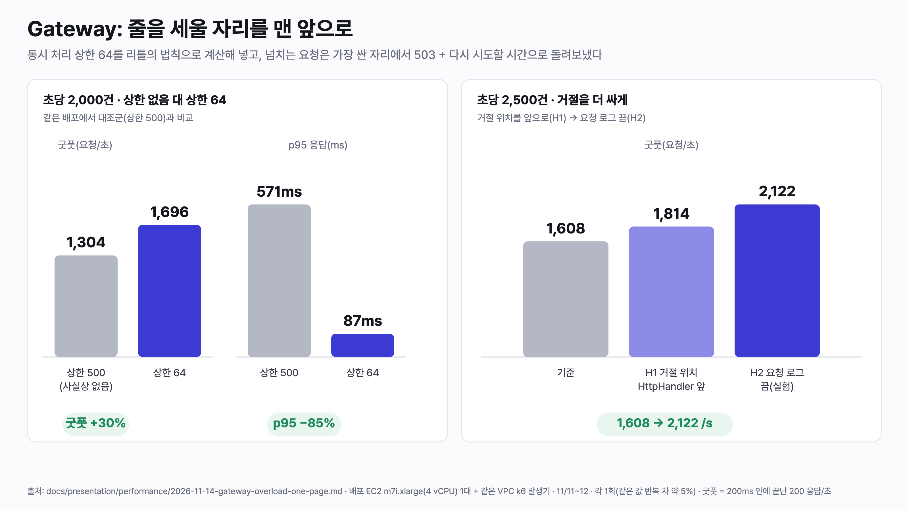

<table>
  <tr>
    <td width="50%">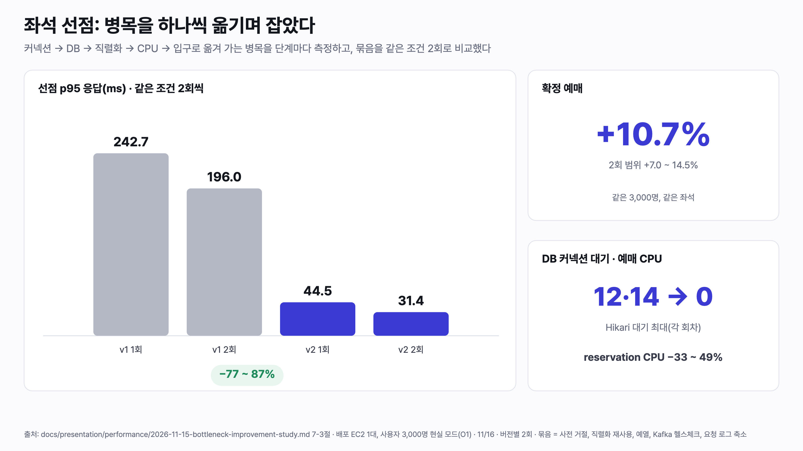</td>
    <td width="50%">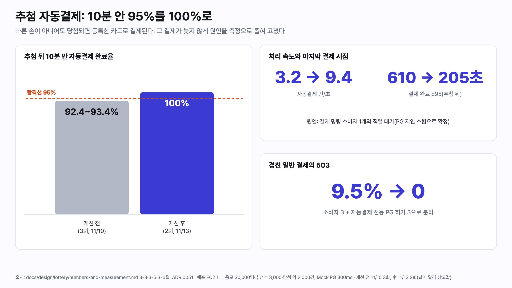</td>
  </tr>
  <tr>
    <td align="center"><b>좌석 선점</b> · 개선 묶음 v1 → v2</td>
    <td align="center"><b>추첨 자동결제</b> · 10분 안 100%</td>
  </tr>
</table>

자세한 과정은 [Gateway 과부하 한 장 요약](docs/presentation/performance/2026-11-14-gateway-overload-one-page.md), [좌석 선점 병목 개선](docs/presentation/performance/2026-11-15-bottleneck-improvement-study.md), [추첨 측정](docs/design/lottery/numbers-and-measurement.md), [Synthetic Data](docs/design/infra/synthetic-data.md)에 있다.

## 정합성: 돈이 걸린 곳

| | 원칙 | 어떻게 |
|---|---|---|
| 🪑 | **판매 판정은 DB가 한다** | 좌석 ID 순으로 조건부 UPDATE를 걸어 고른 좌석을 한 번에 모두 선점하거나 하나도 선점하지 않고, 부분 유니크 인덱스가 마지막 방어선이 된다. Redis는 대기열·캐시·로그아웃 목록에만 쓴다 |
| ❓ | **결과를 모르면 "결과 모름"으로 둔다** | PG 응답 시간 초과는 실패가 아니라 UNKNOWN으로 두고 다시 조회해 확정한다. 재시도 요청이 기존 결제를 이어받지 않게 해 이중 승인을 막았다(ADR 0048) |
| 🔁 | **유실과 중복을 함께 막는다** | Outbox, 처리 이력, DLQ, `Idempotency-Key`, 예매 한 건당 결제 한 건 제약, "이전 상태일 때만" 바꾸는 조건부 갱신 |
| 🔍 | **대사는 고치지 않고 알린다** | 5분마다 결제와 예매를 8가지 규칙(RC-1~RC-8)으로 대조하고, 불일치는 기록과 알림만 남긴다(ADR 0029) |
| 🔑 | **키를 나눈다** | 결제 토큰은 ES256으로 예매 서비스만 서명하고, 빌링키는 AES-256-GCM으로 암호화해 키는 환경 변수로만 넣는다 |

## 운영: 배포와 알림

main에 머지하면 GitHub Actions가 이미지 9개를 커밋 번호로 빌드하고, 별도 Jenkins 서버가 배포 서버에 반영한 뒤 헬스 체크와 스모크 테스트를 돌린다. 실패하면 직전 성공 커밋으로 자동으로 되돌린다(11/11에 실제로 한 번 동작했다, TS-55). 배포 단계, 장애 경보, 측정 모드는 모두 Slack으로 알린다.

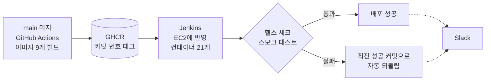

<table>
  <tr>
    <td width="50%">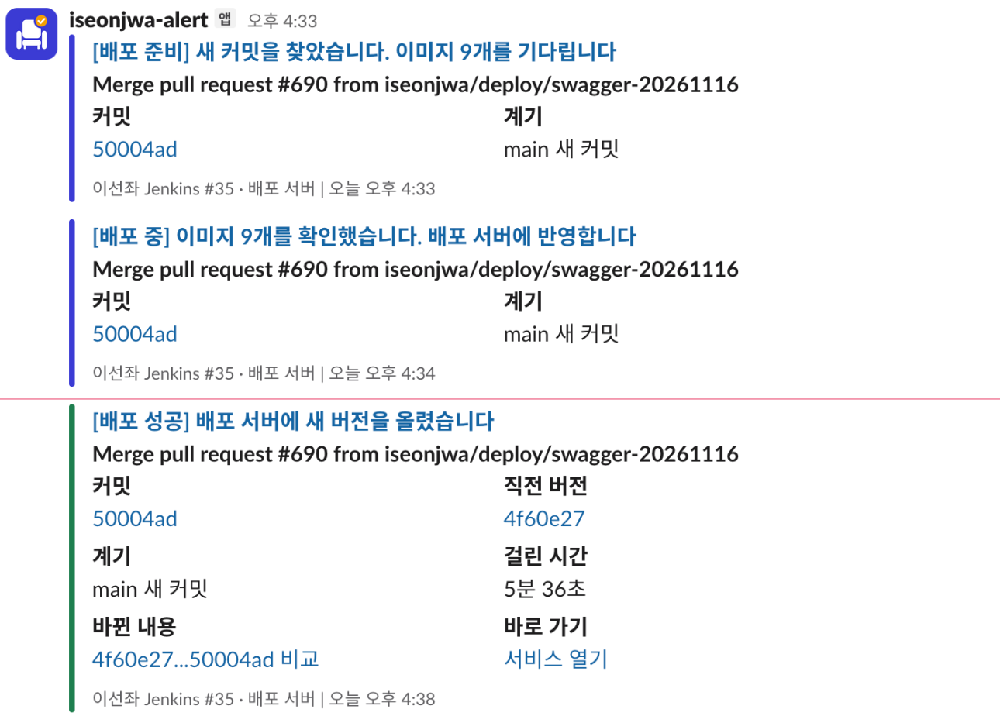</td>
    <td width="50%">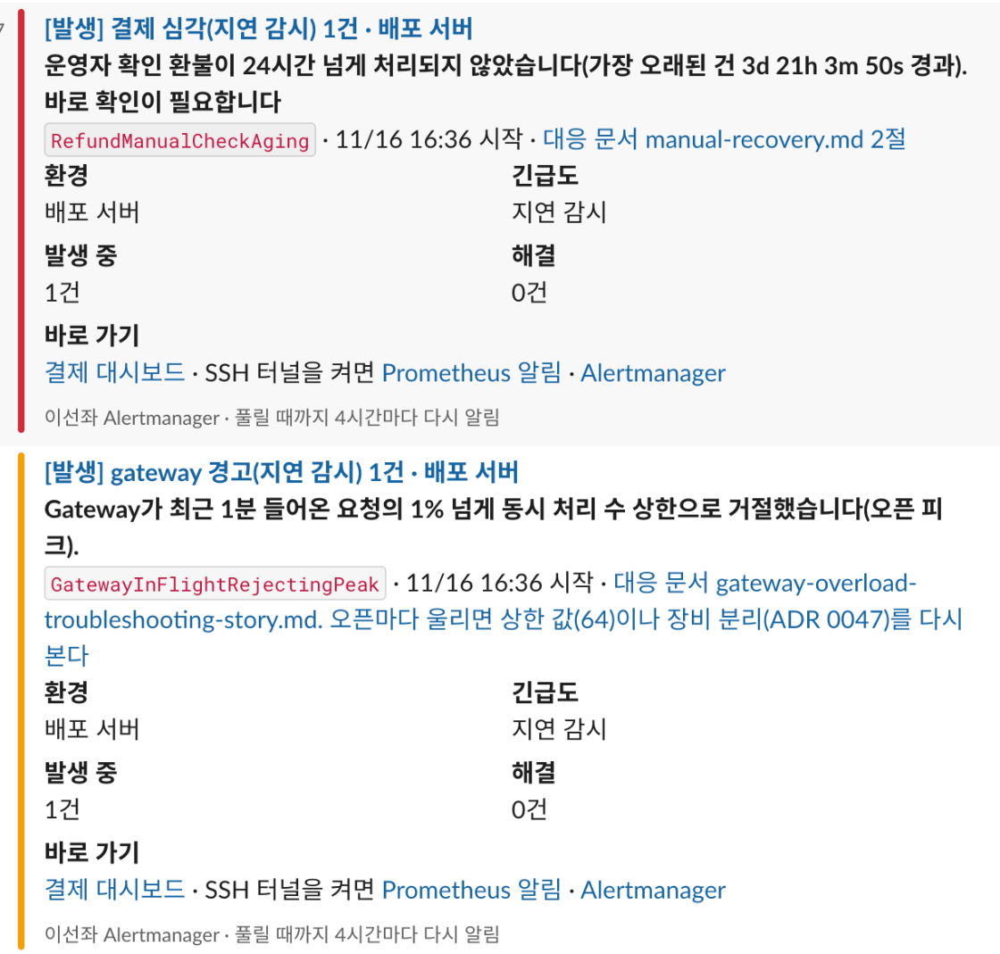</td>
  </tr>
  <tr>
    <td align="center"><b>배포 알림</b> · 준비 → 배포 중 → 성공</td>
    <td align="center"><b>장애 경보</b> · Alertmanager → Slack</td>
  </tr>
</table>

## AI와 일하는 방식

코드 대부분을 AI(Claude Code, codex)와 함께 썼다. 그래서 처음부터 "AI가 쓴 코드를 어떻게 믿을 것인가"를 고민했고, 답은 다음과 같았다.

> **AI가 쓰고, 사람이 판단하고, 그 판단은 기록으로 남긴다.**

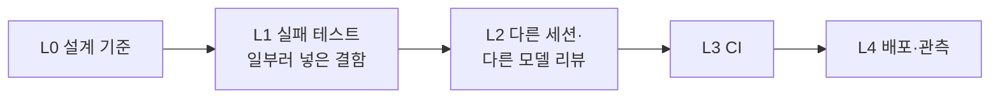

- **기본 프롬프트 제약**: 모든 AI가 먼저 읽는 [`AGENTS.md`](AGENTS.md)에 대전제 11개를 두었다. AI 판단은 모두 기록하고, 검증 근거 없이 완료라고 말하지 않으며, 팀이 합의한 설계를 AI 판단으로 덮어쓰지 않는다.
- **장치**: 입력할 때마다 "판단이면 기록하라"고 다시 알리는 훅, 작업을 마치기 전과 PR마다 기록 구조를 검사하는 `records-check`(종료 훅·CI), 공용 스킬 4개, PR 템플릿의 "AI 활용 기록" 칸, Claude와 codex로 PR을 읽기 전용 리뷰하는 [`script/ai-review.sh`](script/ai-review.sh).
- **다섯 겹 검토**: 위 그림의 L0~L4다. 각 겹이 실제로 잡은 결함은 [`docs/guides/ai-code-review.md`](docs/guides/ai-code-review.md)에 있다.
- **AI가 틀린 것을 숫자로 바로잡았다**: "Gateway에는 bulkhead가 없다"는 바이트코드로 기본값 25를 확인해 뒤집었고, "SKIP LOCKED의 손해는 드물다"는 측정에서 성공 83 → 56건이 나와 거부했다.

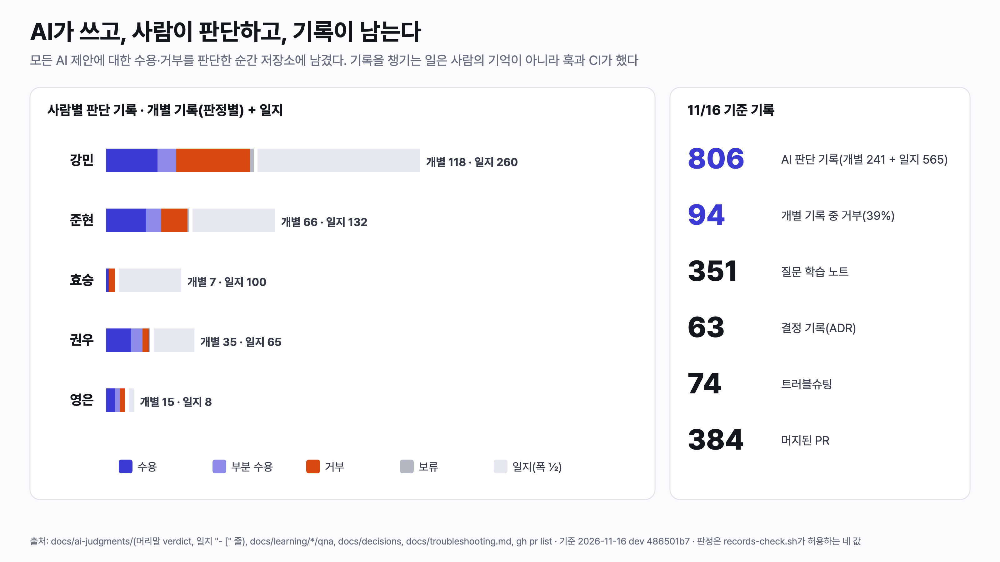

판단 기록은 [`docs/ai-judgments/`](docs/ai-judgments/), 질문 노트 351개는 [`docs/learning/`](docs/learning/), 설계 검증 로그 11건은 SA 14장에 있다.

## 기술적 의사결정

| 결정 | 이유 | 근거 |
|---|---|---|
| 서비스 3개, 대기열·추첨은 예매 안의 모듈 | 떼어 내도 장애가 격리되지 않음. AI의 Queue 분리 권고는 거부 | SA 7-1, 14장 #1 |
| 판매 판정은 DB 조건부 갱신 + 부분 유니크 | Redis가 느려지거나 데이터를 잃어도 판매 기록은 틀어지지 않음 | SA 8-4 |
| Gateway 맨 앞 동시 처리 상한 64 | 리틀의 법칙으로 계산한 60~67, 128은 차이가 측정 편차 안이라 거부 | ADR 0050·0052 |
| 입장 토큰은 선점 성공 순간 사용 처리 | "선점 → 만료 → 다시 선점"으로 좌석을 붙잡는 것을 막음 | ADR 0053 |
| 오케스트레이션 대신 코레오그래피 SAGA | 일반 예매 참여 서비스가 예매·결제 둘뿐 | SA 14장 #3 |
| 결과 모름(UNKNOWN) + 재시도 이어받기 거부 | 이전 요청이 PG를 부르지 않았다고 확인할 수 없음 | ADR 0018·0048 |
| 자동결제 소비자 3 + 전용 PG 허가 | 원인이 소비자 하나의 직렬 대기임을 측정으로 확인 | ADR 0051 |
| 좌석 배치 캐시는 서비스 메모리에 | p95 Redis 38.3ms 대 로컬 7.0ms, CPU 약 4.5배 | ADR 0054 |
| AI 상담은 벡터 DB 없이 키워드 검색 + 출처 인용 | 문서가 수천 토큰이라 충분, 임베딩 비용·기간 절약 | ADR 0049 |
| 잠금 대기 50ms(SKIP LOCKED 거부) | SKIP LOCKED는 곧 풀릴 좌석까지 실패로 돌려보냄 | ADR 0061, TS-73 |

결정 기록 63건은 [`docs/decisions/`](docs/decisions/), 트러블슈팅 74건은 [`docs/troubleshooting.md`](docs/troubleshooting.md)에 있다.

## 알려진 한계

> [!WARNING]
> - 장비 한 대(4 vCPU)와 Kafka 브로커 1대로 운영해, 상한과 커넥션 풀 조정은 요청이 기다리는 위치만 바꾼다.
> - 오픈 순간의 대기열 진입 요청 일부가 Gateway 상한에 막힌다. 추첨 직후에는 일반 선점 p95가 90% 늘어 목표(20% 이하)에 못 미쳤다.
> - 부하 측정은 Mock PG로만 했고, 토스페이먼츠는 일반 결제 테스트 모드까지만 연결했다.
> - RAG 상담은 검색 정확도(골든 질문 10개)까지만 확인했고 답변 품질은 평가하지 못했다.

## 팀

<table>
  <tr>
    <td align="center" width="20%"><a href="https://github.com/alloy31"><br><b>안준현</b></a><br><sub>@alloy31</sub></td>
    <td align="center" width="20%"><a href="https://github.com/KWON-WOO"><br><b>최권우</b></a><br><sub>@KWON-WOO</sub></td>
    <td align="center" width="20%"><a href="https://github.com/GGangMY"><br><b>이강민</b></a><br><sub>@GGangMY</sub></td>
    <td align="center" width="20%"><a href="https://github.com/hyos1"><br><b>반효승</b></a><br><sub>@hyos1</sub></td>
    <td align="center" width="20%"><a href="https://github.com/alreadysolved"><br><b>권영은</b></a><br><sub>@alreadysolved</sub></td>
  </tr>
  <tr>
    <td valign="top"><sub>결제·Mock PG·이벤트 신뢰성 공통 모듈, 프론트엔드, AI 상담, 배포·관측, 저장소 AI 규칙과 기록 체계</sub></td>
    <td valign="top"><sub>동기형·접수형 좌석 선점과 동시성 검증</sub></td>
    <td valign="top"><sub>사용자·공통 모듈, 추첨과 자동결제, Gateway 과부하 측정과 개선, 발표</sub></td>
    <td valign="top"><sub>공연·좌석 조회, 예매 상태·발권·보상, 취소, 좌석 캐시</sub></td>
    <td valign="top"><sub>대기열과 입장 토큰, 부하 테스트와 Synthetic Data</sub></td>
  </tr>
</table>

## 저장소 구성

```text
.
├── gateway/  eureka/  config-server/  config-repo/   진입점, 서비스 발견, 설정 서버와 설정
├── user-service/  reservation-service/  payment-service/
│   assistant-service/  mock-pg/                      서비스
├── common*/                                          공통 모듈(공통 응답 형식, Outbox·처리 이력·DLQ 등)
├── frontend/                                         React 화면과 MSW 목, Playwright E2E
├── infra/  compose*.yml  Jenkinsfile                 관측 설정, 로컬·배포 compose, 배포 파이프라인
├── loadtest/                                         k6 시나리오와 Synthetic Data 생성기
└── docs/                                             설계, 결정, 트러블슈팅, AI 판단 기록, 학습 노트, 발표 자료
```

---

## 팀원을 위한 안내

<details>
<summary><b>처음 시작하기</b> · clone한 뒤 3분</summary>

1. Claude Code를 쓰면 스킬을 연결한다. 저장소 루트에서 `script/setup-agents.sh`를 실행한다. 공용 스킬(`.agents/skills/`)이 `.claude/skills/`에 연결된다. pull로 스킬이 바뀌면 다시 실행한다. Windows는 Git Bash에서 실행한다. 심볼릭 링크를 못 만들면 복사로 대신하며, 이때는 원본이 바뀔 때마다 다시 실행해야 한다.
2. 내 폴더는 에이전트가 만든다. 처음 질문하거나 AI 판단을 내리면 에이전트가 `docs/learning/<이름>/`과 `docs/ai-judgments/<이름>/`을 만들어 준다. `<이름>`은 팀원 영문 이름(예: junhyun)이다. 다른 사람 폴더는 고치지 않는다.
3. Claude Code는 저장소 루트에서 연다. `.claude/settings.json`의 훅이 자동으로 적용된다. 별도 설정은 없다. Codex는 훅이 없고 `AGENTS.md`를 읽고 따른다.

</details>

<details>
<summary><b>기록은 에이전트가 남긴다</b></summary>

| 상황 | 기록 위치 | 스킬 |
|---|---|---|
| 개념·방법을 물었다 | `docs/learning/<이름>/qna/` | `learning-note` |
| AI의 응답·제안을 수용·거부·보류·선택했다 | `docs/ai-judgments/<이름>/` | `ai-judgment` |
| 되돌리기 어려운 결정을 했다 | `docs/decisions/` | `adr` |
| 막혔던 문제를 해결했다 | `docs/troubleshooting.md` | `troubleshooting` |

- 에이전트는 동의를 기다리지 않고 기록하고 답 끝에 `기록: <경로>`를 남긴다. 사람은 PR에서 기록을 검토하고 고친다.
- 팀이 함께 알아야 할 AI 판단은 기록 머리말에 `shared: 예`를 쓰고 [`docs/ai-judgments/README.md`](docs/ai-judgments/README.md)의 "팀 공통 판단" 표에 올린다.
- 판단 근거는 사용자가 말한 대로 적는다. 말하지 않았으면 `미기재`로 남고, 판단자가 나중에 채운다.
- 기록 구조는 `script/records-check.sh`로 확인한다. Claude Code는 종료 전에 자동으로, GitHub는 PR마다 검사한다.
- 비밀값(`.env`, 토큰, 실제 비밀번호)은 커밋하지 않는다.

</details>

<details>
<summary><b>개발 워크스페이스</b></summary>

Java 21, Spring Boot 4.1.2, Spring Cloud 2025.1.4 기반의 앱 8개(Config Server·Eureka·Gateway·User·Reservation·Payment·Assistant·Mock PG)와 공통 라이브러리, 전체 인프라를 준비한다. 검증·개발 도구는 Java·Gradle로 통일하며 Python 설치는 필요 없다.

```bash
./gradlew initLocalEnv
docker compose -f compose.yml -f compose.local.yml up -d --build --wait --wait-timeout 180
./gradlew :system-tests:systemTest -PredisFailure=true --no-daemon
```

전체 검사는 `./gradlew verifyWorkspace --no-daemon`으로 실행한다. 환경·앱 실행은 [워크스페이스 가이드](docs/guides/workspace.md), JUnit 위치와 실행 범위는 [테스트 가이드](docs/guides/testing.md)를 따른다.

</details>

<details>
<summary><b>PR과 문서 지도</b></summary>

`.github/pull_request_template.md`가 자동으로 채워진다. STAR(상황·과제·행동·결과) 형식이고, 이 PR에 쓴 AI 판단 기록 링크를 적는 칸이 있다.

문서는 [`docs/README.md`](docs/README.md)에서 시작한다. 에이전트 공통 규칙의 정본은 [`AGENTS.md`](AGENTS.md)이고, Claude Code 전용 기능은 [`CLAUDE.md`](CLAUDE.md)에 있다.

</details>
